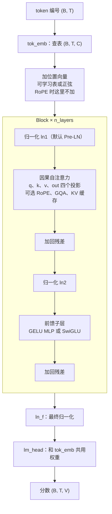
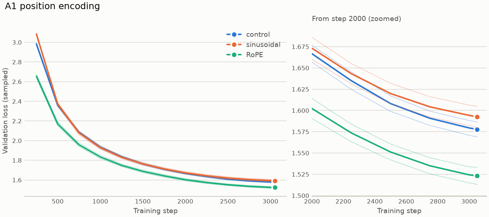
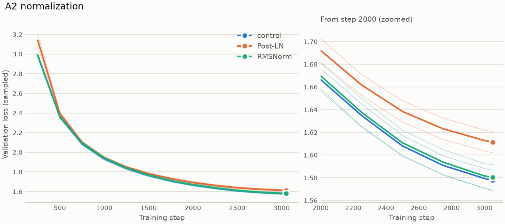
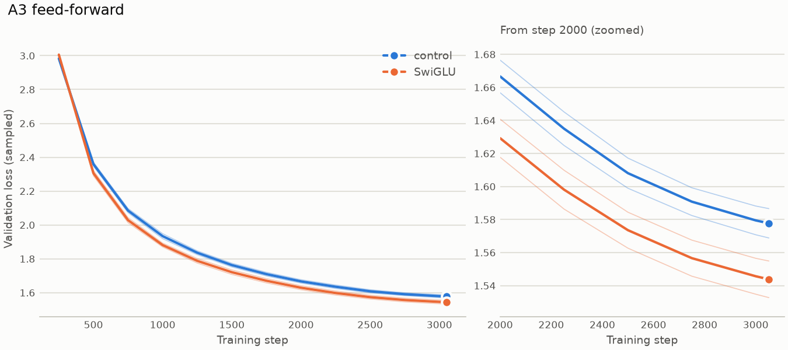
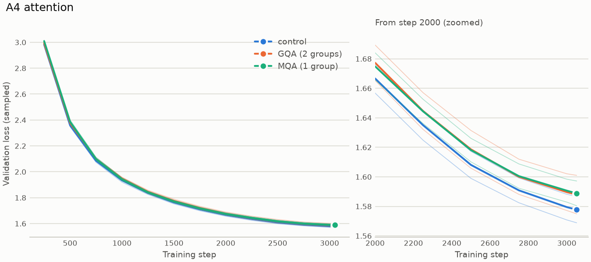
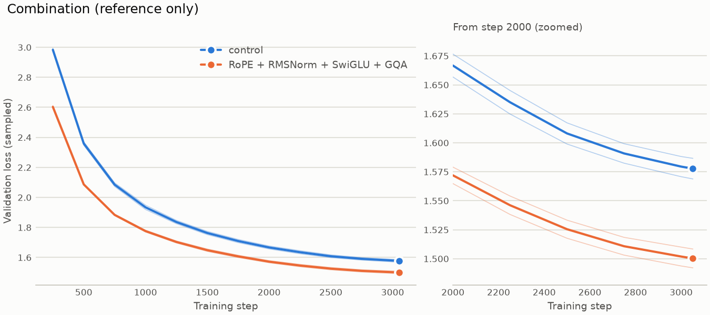
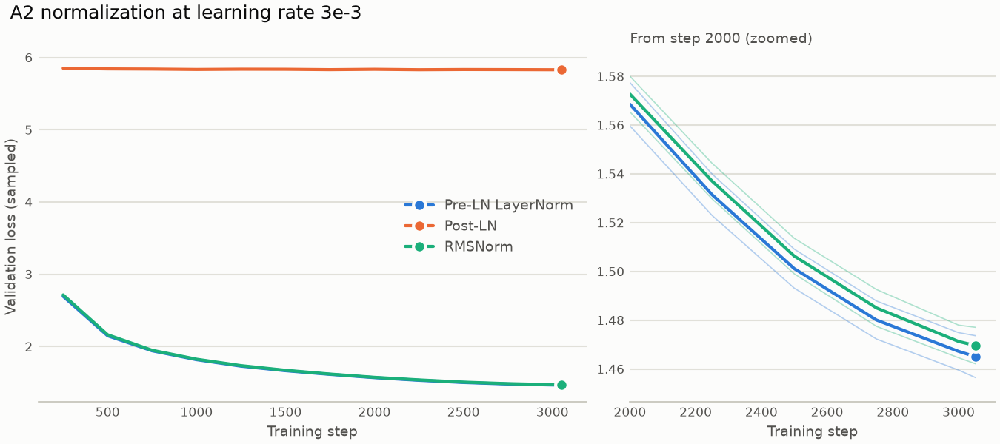

# transformer-lab

从零实现的 Llama/Qwen 风格 Decoder-only Transformer。项目包括：在 TinyStories 上预训练小模型并逐个组件做消融实验；用同一套实现载入 Qwen3-0.6B 的官方权重并与 `transformers` 逐层对齐；用手写的 LoRA 在 GSM8K 上做监督微调（SFT），并与 HF PEFT 对照。

模型、注意力、归一化、位置编码、训练循环与 LoRA 均为从零实现，未使用 `nn.Transformer`、`nn.MultiheadAttention` 或 `transformers`、`peft` 的模型类；后两者只用于对照实验和测试。文中数字均为实际运行结果，完整分析见[实验报告](docs/report.md)。

## 主要结果

- **权重对齐：** 自研架构载入 Qwen3-0.6B（596,049,920 个参数）后，fp32 下 logits 与官方实现的最大误差为 1.73e-04；RMSNorm 内部改用 fp32 计算后，GPU bf16 下三个提示的每一层输出均逐位相同。
- **LoRA 实现：** 手写 LoRA 与 HF PEFT 从相同初值出发训练 454 步，每一步的 train loss 和最终的 val loss 均逐位相同。
- **结构消融：** 约 1,400 万参数的模型，每个变体 1 亿 token、2 个种子。RoPE 和 SwiGLU 分别使 val loss 降低 0.0523 和 0.0339；Post-LN、正弦位置编码、GQA-2、MQA 均更差。
- **监督微调：** GSM8K 固定 500 题上，在 eos 处停止的题目由 32/500 增至 483/500；准确率由 48.4% 变为 49.2%（r=8 两个种子的均值），未超过种子间差距，按项目的判定规则差异不显著。

## 模型结构



每个组件都能通过配置文件切换，这样消融时每次只改一个变量：

| 开关 | 取值 | 默认（对照组） |
| --- | --- | --- |
| `pos_encoding` | `learned`、`sinusoidal`、`rope` | `learned` |
| `norm` | `layernorm`、`rmsnorm` | `layernorm` |
| `norm_position` | `pre`、`post` | `pre` |
| `mlp` | `gelu`、`swiglu` | `gelu` |
| `n_kv_heads` | 能整除 `n_heads` 的正整数 | 不写，等于 `n_heads`（MHA） |
| `head_dim` | 正整数，配 RoPE 时要是偶数 | 不写，等于 `d_model // n_heads` |
| `qk_norm` | `true`、`false` | `false` |
| `mlp_hidden_dim` | 正整数，只用于 SwiGLU | 不写，等于 `8 * d_model // 3` |
| `rmsnorm_fp32` | `true`、`false`（RMSNorm 内部先转 fp32，和 Qwen3 官方相同） | `false`；载入 Qwen3 时自动打开 |

生成时可以用 KV 缓存：`generate(..., use_cache=True)` 或 `scripts/sample.py --cache`，生成的文字不变。

## 消融实验

**设置：**

- **数据：** TinyStories，8192 词表的 BPE。
- **模型：** 6 层、6 头、C=384、上下文 512。
- **训练：** 每次 1 亿 token（3052 步，batch 32 × 累积 2），学习率 6e-4 按 cosine 降到 6e-5，RTX 5060 Laptop 8GB，bf16。
- **打分：** 完整验证集，共 5,414,547 个 token。
- **对比方式：** 每个变体和对照组只差一个组件，每个变体 2 个种子（1337、2024）。
- **判定规则：** 均值之差大于两者种子间差距中的较大者才算有结论，否则记“差异不显著”；两个种子的方向相反时，要补第 3 个种子才能下结论。

### 结果

| 变体 | 改了什么 | 参数量 | 种子 1337 | 种子 2024 | 均值 | 与对照差 | 结论 |
| --- | --- | --- | --- | --- | --- | --- | --- |
| `a0_control` | 对照：可学习位置表、Pre-LN LayerNorm、GELU、MHA | 13,969,152 | 1.5785 | 1.5814 | 1.5799 | — | — |
| `a1_sinusoidal` | 正弦位置编码 | 13,772,544 | 1.5960 | 1.5911 | 1.5935 | +0.0136 | 更差 |
| `a1_rope` | RoPE | 13,772,544 | 1.5281 | 1.5272 | 1.5277 | -0.0523 | 更好 |
| `a2_postln` | Post-LN | 13,968,384 | 1.6124 | 1.6150 | 1.6137 | +0.0338 | 更差 |
| `a2_rmsnorm` | RMSNorm | 13,964,160 | 1.5829 | 1.5814 | 1.5822 | +0.0022 | 差异不显著 |
| `a3_swiglu` | SwiGLU | 13,969,152 | 1.5469 | 1.5451 | 1.5460 | -0.0339 | 更好 |
| `a4_gqa2` | GQA：6 个头共用 2 组 k、v | 12,789,504 | 1.5943 | 1.5883 | 1.5913 | +0.0114 | 更差 |
| `a4_mqa` | MQA：6 个头共用 1 组 k、v | 12,494,592 | 1.5902 | 1.5943 | 1.5923 | +0.0123 | 更差 |
| `a9_modern` | 组合：RoPE + RMSNorm + SwiGLU + GQA-2，只作参考 | 12,587,904 | 1.5001 | 1.5044 | 1.5023 | -0.0777 | 更好 |

完整表格由脚本生成，见 [SUMMARY.md](experiments/m3_ablations/SUMMARY.md)。

- **RoPE 是最大的单项改进：** 参数还比对照少 1.4%。
- **SwiGLU 参数量和对照完全相同，** 所以这个差距不是靠多加参数换来的。
- **GQA、MQA 比对照差：** 这个差值里同时有容量变小和 k、v 共用两个因素，这组实验分不开。
- **GQA-2 和 MQA 之间没有结论：** 均值只差 0.0009，两个种子的方向相反（+0.0041、-0.0060）。按规则要补第 3 个种子才能比较，这次没有补。
- **组合在学习率 6e-4 的变体里分数最低，** 但它同时改了四个组件，不能把增益分给其中某一个。











曲线是训练中每 250 步按 20 个 batch 抽样的 val loss，所以末端和上表的完整验证集分数略有差别。粗线是两个种子的均值，淡线是每个种子，右边放大最后一段。

### 高学习率下的归一化

把学习率提高到 3e-3（降到 3e-4），其余不变：

| 变体 | 种子 1337 | 种子 2024 | 均值 | 情况 |
| --- | --- | --- | --- | --- |
| `a2_preln_lr3e-3` | 1.4651 | 1.4653 | 1.4652 | 未发散 |
| `a2_rmsnorm_lr3e-3` | 1.4694 | 1.4717 | 1.4705 | 未发散 |
| `a2_postln_lr3e-3` | 5.8343 | 5.8352 | 5.8347 | 未发散，但未收敛 |



- **Post-LN 学不动：** 从第 250 步到最后都停在 5.83–5.85 附近。这接近只按词频预测的水平（约 5.83，是在样本数据上用另一份词表算的，只作近似），所以推断模型只学到了 token 频率。这是根据数值作的推断，权重到底发生了什么没有检查。
- **Pre-LN 下降得更低：** 比 6e-4 的对照低约 0.115，说明在这个预算下 6e-4 偏小。上面所有的对比仍然都用 6e-4。

### 外推：在 2 倍训练长度上打分

只有正弦和 RoPE 能做，可学习位置表只有 512 行。窗口长度 1024，前半段的位置都训练过，后半段超出了训练长度：

| 变体 | 种子 | 前半段 | 后半段 |
| --- | --- | --- | --- |
| `a1_sinusoidal` | 1337 | 1.5971 | 4.9251 |
| `a1_sinusoidal` | 2024 | 1.5925 | 5.0564 |
| `a1_rope` | 1337 | 1.5297 | 2.3010 |
| `a1_rope` | 2024 | 1.5287 | 2.1253 |

RoPE 没有长度上限，比正弦也稳得多，但超出训练长度后同样明显变差。注意后半段的上下文也更长，差值同时包含两个影响，不能全算到位置头上。

### 速度与显存

用随机权重和随机 token 做短测，不读数据，每项取 3 次的中位数。对照组自己 3 次的训练吞吐相差 3.8%，比这小的差别不算结论。

| 变体 | 训练 tokens/s | 相对对照 | 训练显存峰值 MiB | 相对对照 |
| --- | --- | --- | --- | --- |
| `a0_control` | 86,758 | — | 4,750 | — |
| `a1_rope` | 77,302 | -10.9% | 4,751 | +1 |
| `a2_rmsnorm` | 79,798 | -8.0% | 5,061 | +311 |
| `a3_swiglu` | 82,948 | -4.4% | 5,011 | +261 |
| `a4_gqa2` | 87,704 | +1.1% | 4,732 | -18 |
| `a4_mqa` | 88,163 | +1.6% | 4,728 | -23 |
| `a9_modern` | 74,706 | -13.9% | 5,303 | +552 |

### KV 缓存的收益

对照结构，随机权重，贪心生成，开头 32 个 token，新生成 480 个。RTX 5060 每项 5 次，CPU 每项 3 次，取中位数；tokens/s 是整个 batch 的总和：

| 设备 | 变体 | B | 无缓存 tokens/s | 有缓存 tokens/s | 倍数 | 无缓存峰值 MiB | 有缓存峰值 MiB |
| --- | --- | --- | --- | --- | --- | --- | --- |
| RTX 5060 | `a0_control` | 1 | 322 | 320 | 1.00 | 115 | 103 |
| RTX 5060 | `a0_control` | 8 | 1,261 | 2,334 | 1.85 | 239 | 140 |
| RTX 5060 | `a0_control` | 32 | 1,157 | 7,866 | 6.80 | 662 | 267 |
| RTX 5060 | `a4_gqa2` | 1 | 307 | 278 | 0.91 | 109 | 93 |
| RTX 5060 | `a4_gqa2` | 8 | 1,289 | 2,335 | 1.81 | 232 | 110 |
| RTX 5060 | `a4_gqa2` | 32 | 1,197 | 8,348 | 6.98 | 658 | 167 |
| CPU（i7-14650HX） | `a0_control` | 1 | 39 | 288 | 7.42 | — | — |

- **B=1 时 RTX 5060 上几乎不提速。** 有缓存时每步约 3 ms，B 涨到 32 也只到约 4 ms；无缓存时从约 3 ms 涨到约 28 ms。也就是说，B=1 时计算量很小，时间主要花在固定开销上，缓存省不出什么。这个固定开销由什么构成没有直接测量，只有“每步耗时大致跟操作数走”这个拟合间接支持。
- **计算量够大时才明显：** B=32 或 CPU 上都有约 7 倍。B=32 时对照组有缓存的五次是 4,211–8,992 tokens/s，波动不小，所以 6.80 这个数不算很稳；即使取最慢除以最快，也有约 3.6 倍。
- **GQA 省的缓存能直接看到：** B=32 时，有缓存的对照和 GQA-2 峰值差 100.1 MiB，手算是缓存差 96.0 加参数差 4.5，共 100.5 MiB。
- **这个小模型上缓存没有增加显存峰值，** 有缓存反而更低。

### 生成样例

用每个变体种子 1337 的最终存档在 RTX 5060 上生成：开头 `Once upon a time`，新生成 300 个 token，temperature 0.8，top-k 50，使用 KV 缓存。下面是节选，一字未改；全部 12 个变体、每个 3 段见 [samples.md](experiments/m3_ablations/samples.md)。

对照（`a0_control`）：

```text
Once upon a time, in a small town, there was a little boy named Tim. Tim was a happy boy who loved to play outside. One day, it was very cold outside, and Tim could not find his toy car. He felt sad and started to feel sad.……
```

组合（`a9_modern`）：

```text
Once upon a time, in a small town, there lived a humble cat named Kitty. Kitty loved to play with her ball and run around the town. One day, she saw a big tree and decided to climb it.
As Kitty climbed higher and higher, she saw a lot of birds in the sky. "I wish I could fly like them," said Kitty.……
```

高学习率的 Post-LN（`a2_postln_lr3e-3`，未收敛）：

```text
Once upon a time. he, was., the... mom the., and a to and... a of.. you and said she friends the, was the a. the. He to She were it. so not the you the had.." and to day in they and to " the and a. wa……
```

- **收敛的 11 个变体** 都能写出语法基本通顺的儿童故事，但前后逻辑常常对不上。分数相差 0.01–0.05 的变体，从这几段样例看不出高下，比较还是要看上面的结果表。
- **未收敛的 Post-LN** 只是在堆高频词和标点，这和“模型只学到了 token 频率”的推断相符，但仍然不是对权重的检查。

### 结论的适用范围

- 所有结论只适用于这个 6 层小模型和 1 亿 token 的预算，每个变体只有 2 个种子；除“高学习率”一节外，学习率都是 6e-4。
- 训练吞吐只看短测，长训练的吞吐受温度和频率影响，不作结论。
- RoPE 和 RMSNorm 确实更慢，RMSNorm 和 SwiGLU 确实更占显存，这里只测了差多少，没有拆开测原因。

## 载入 Qwen3-0.6B 官方权重

用上面同一套代码载入 [Qwen3-0.6B](https://huggingface.co/Qwen/Qwen3-0.6B) 的官方权重（596,049,920 个参数），和 `transformers` 的官方实现逐层对比。结构靠配置开关切换，不需要另写模型。

结果（Mac CPU，fp32，`transformers` 5.22.2，eager 注意力，每个提示贪心生成 50 个新 token）：

| 提示 | token 数 | 分数最大误差 | 分数最大值 | 每层最大相对误差 | 贪心生成（有缓存、无缓存） |
| --- | --- | --- | --- | --- | --- |
| 英文 | 10 | 4.77e-05 | 22.6 | 9.78e-07 | 相同 |
| 中文 | 8 | 4.24e-05 | 17.6 | 1.56e-06 | 相同 |
| 较长的英文 | 34 | 1.73e-04 | 27.1 | 4.05e-06 | 相同 |

验收标准是 fp32 下分数最大误差在 1e-4 量级、贪心生成一致，都满足。记录见 [alignment.json](experiments/m4_qwen3/alignment.json)。

- **误差只来自一处浮点舍入：** 本实现写作 `scores / d**0.5`，官方是 `scores * d**-0.5`，数学上相同。在代码副本里改成官方的写法后，三个提示每一层的误差都是 0.0（[记录](experiments/m4_qwen3/alignment_official_scaling.json)），说明结构和权重映射没有差别。正式代码保留原写法，以保证此前预训练和消融的结果能逐字复现。
- **GPU 和 bf16 下：** 官方的 RMSNorm 内部会先转成 fp32。加入同样的开关 `rmsnorm_fp32`（载入 Qwen3 时打开）后，RTX 5060 上 bf16 的分数最大误差从 0.65625 变成 0.0。记录见 [experiments/m5_gsm8k/](experiments/m5_gsm8k/)。

自研模型生成的文字（没有用对话模板，只是接着写）：

```text
Once upon a time, in a small town by the sea, there lived an old fisherman who went out every morning before the sun came up. One day he found a small boat on the beach, and he decided to go out on it. He took the boat to the sea, and soon he found that the boat was full of fish.……
```

## LoRA 监督微调

用手写的 `LoRALinear` 在 GSM8K 上微调 Qwen3-0.6B-Base（用自研架构载入），并和 HF + PEFT 的官方实现对比。完整结果和设置见 [experiments/m5_gsm8k/SUMMARY.md](experiments/m5_gsm8k/SUMMARY.md)。

- **训练：** LoRA 装在每层的 q、k、v、out 投影上，alpha 16，学习率 2e-4，微批 2 × 累积 8，1 个 epoch（7,273 题，454 步），只对答案算 loss，RTX 5060 Laptop 8 GB，bf16。
- **评测：** 测试集里固定的 500 题，贪心解码；500 题的标准误约 2.2 个百分点。

### 与 PEFT 的对照

PEFT 从同一个初始 A、B 出发，用同样的数据、顺序、训练循环和超参数训练：

| 项目 | 自研 LoRA | PEFT |
| --- | --- | --- |
| 最后的 val loss | 0.49689202362882706 | 0.49689202362882706 |
| 显存峰值 | 7,338 MiB | 7,341 MiB |
| 训练用时 | 8.6 分钟 | 9.1 分钟 |

| 比较 | 数值 |
| --- | --- |
| 步数 | 454 |
| 第 1 步的 train loss 差 | 0.0 |
| 每步 train loss 差的平均 / 最大 | 0.0 / 0.0 |
| 最后的 val loss 差 | 0.0 |
| 参照：自研换种子，最后的 val loss 差 | 0.00039 |
| 门槛（跑之前定好） | 每步平均 ≤ 0.01，最后 val ≤ 0.01 |
| 结论 | 达标 |

这说明自研的架构加手写的 LoRA，和官方 Qwen3 加 PEFT 做的是同一套计算，连 bf16 下的舍入都一样。

### 微调前后对比

| 模型 | 提示 | 答对 | 准确率 | 在 eos 停下 | 平均新 token |
| --- | --- | --- | --- | --- | --- |
| 基座 | few-shot（4 个例子） | 234/500 | 46.8% | 335/500 | 204.0 |
| 基座 | 不给例子 | 242/500 | 48.4% | 32/500 | 250.7 |
| LoRA SFT r=8，种子 1337 | 不给例子 | 254/500 | 50.8% | 483/500 | 90.8 |
| LoRA SFT r=8，种子 2024 | 不给例子 | 238/500 | 47.6% | 484/500 | 94.9 |
| LoRA SFT，8 次合计 | 不给例子 | 1990/4000 | 49.8% | — | — |

SFT 之后，模型学会了按 `#### 数字` 作答、答完就停下，但准确率只比基座高 1–3 个百分点，没有超过种子之间的差距，按判定规则是差异不显著。原因没有验证；推断之一是基座在预训练时已经见过大量类似的数学数据。

### LoRA 秩（rank）的影响

| r | 可训练参数 | 占全部参数 | 种子 1337 | 种子 2024 | 均值 | 种子间差距 | 与 r=8 差 | 结论 | 最后的 val loss（均值） | 显存峰值 | 训练用时 |
| --- | --- | --- | --- | --- | --- | --- | --- | --- | --- | --- | --- |
| 4 | 1,146,880 | 0.19% | 48.6% | 49.4% | 49.0% | 0.8 | -0.2 | 差异不显著 | 0.4971 | 7,318 MiB | 9.2 分钟 |
| 8 | 2,293,760 | 0.38% | 50.8% | 47.6% | 49.2% | 3.2 | — | 对照 | 0.4971 | 7,338 MiB | 8.9 分钟 |
| 16 | 4,587,520 | 0.77% | 49.4% | 51.6% | 50.5% | 2.2 | +1.3 | 差异不显著 | 0.4969 | 7,379 MiB | 9.2 分钟 |
| 32 | 9,175,040 | 1.54% | 50.8% | 49.8% | 50.3% | 1.0 | +1.1 | 差异不显著 | 0.4972 | 7,461 MiB | 9.2 分钟 |

r 从 4 到 32，可训练参数从 0.19% 到 1.54%，准确率和 val loss 都分不出高下。

## 使用模型

模型由结构（本仓库的代码）和一份权重组成。提供两种用法：

- **续写故事：** 使用在 TinyStories 上从零预训练的小模型。

```bash
uv run python scripts/sample.py --ckpt runs/tinystories_base/ckpt.pt --prompt "Once upon a time" --temperature 0.8 --top-k 50 --cache
```

- **自由提问：** 将 Qwen3 基座载入本实现，可选装上 LoRA。提示格式、贪心解码、截断和抽答案都和评测一样。有测试保证：同一道题，这里的提示、生成的内容和抽出的答案都和评测记录相同；只是模型接着编的新题不显示。

```bash
uv run python scripts/ask.py --lora runs/m5/f2_r8_seed1337/lora.pt "Tom has 3 boxes with 12 pens each. He gives away 7 pens. How many pens does he have left?"
```

不给题目时进入交互模式，一题接一题地问，空行退出；去掉 `--lora` 就是基座。基座在 Mac（MPS）上用 `--max-new-tokens 160` 回答上面这道题：答对了 29，但没有在 eos 停下，160 个 token 用完时已经又编了 399 个字符的新题；`ask.py` 只显示截断之前的部分。

代码审查时在 RTX 5060 上以默认的 256 个 token 对同一道题做了对比（见[审查记录](docs/reviews/codex-m6-ask-eb4e44b.md)）：

| 模型 | 抽出的答案 | 在 eos 停下 | 生成 token | 截掉的续写 |
| --- | --- | --- | --- | --- |
| LoRA SFT r=8，种子 1337 | 29（写成 `#### 29`） | 是 | 34 | 0 个字符 |
| 基座 | 29 | 否，写满 256 个 | 256 | 600 个字符 |

两者答案相同；SFT 改变的是作答格式和答完即停，与微调前后对比中在 eos 停下的题目由 32/500 增至 483/500 是同一现象。

## 环境与安装

- Python 3.11 或 3.12，用 `uv` 管理依赖和锁文件。
- PyTorch 固定为 2.9.1。macOS 从 PyPI 安装，Linux 和 Windows 从官方 CUDA 12.8 源安装（RTX 5060 需要 CUDA 12.8 及以上的构建）。
- MacBook Air M4 用来开发和跑单元测试；Windows + RTX 5060（WSL2 Ubuntu）用来正式训练。设备按 CUDA → MPS → CPU 自动回退。

尚未安装 uv 时，可按 [官方安装说明](https://docs.astral.sh/uv/getting-started/installation/) 安装。然后在项目根目录运行：

```bash
uv sync --locked
```

```bash
uv run pytest
```

```bash
uv run ruff check . && uv run ruff format --check .
```

在 RTX 5060 上自检：

```bash
uv run python -c "import torch; print(torch.__version__, torch.version.cuda, torch.cuda.get_device_name(0)); torch.randn(1).cuda()"
```

## 复现实验

训练一个变体，再在完整验证集上打分（需要先准备好 `data/tinystories/`，见 `scripts/prepare_tinystories.py`）：

```bash
uv run python scripts/train.py --config configs/ablations/a1_rope.yaml seed=1337 out_dir=runs/m3/a1_rope/seed1337
```

```bash
uv run python scripts/eval_full_val.py --ckpt runs/m3/a1_rope/seed1337/ckpt.pt --out runs/m3/a1_rope/seed1337/full_val.json
```

A1 的外推评测（只支持正弦和 RoPE）：

```bash
uv run python scripts/eval_extrapolation.py --ckpt runs/m3/a1_rope/seed1337/ckpt.pt --out runs/m3/a1_rope/seed1337/extrapolation.json
```

载入 Qwen3-0.6B 并和 `transformers` 对比（第一次会下载约 1.5 GB，放在 HuggingFace 默认缓存目录）：

```bash
uv run python scripts/check_qwen3.py --out experiments/m4_qwen3/alignment.json
```

环境里设了 SOCKS 代理时，下载会报缺 `socksio`。如果同时有 HTTP 代理，在命令前加 `env -u ALL_PROXY -u all_proxy`。

微调实验：准备 GSM8K，评测基座，LoRA 微调后再评测（第一次会下载基座权重，约 1.2 GB）：

```bash
uv run python scripts/prepare_gsm8k.py
```

```bash
uv run python scripts/eval_gsm8k.py --config configs/finetune/f1_base_fewshot.yaml --out runs/m5/f1_base_fewshot.json
```

```bash
uv run python scripts/train_sft.py --config configs/finetune/f2_r8.yaml seed=1337 out_dir=runs/m5/f2_r8_seed1337
```

```bash
uv run python scripts/eval_gsm8k.py --config configs/finetune/f1_sft_r8.yaml --out runs/m5/f2_r8_seed1337_eval.json
```

与 PEFT 对照（需先完成上面的训练）：

```bash
uv run python scripts/train_peft.py --config configs/finetune/f4_peft_r8.yaml
```

```bash
uv run python scripts/compare_curves.py --ours runs/m5/f2_r8_seed1337 --theirs runs/m5/f4_peft_r8_seed1337 --out runs/m5/f4_compare.json
```

用仓库里已有的结果重新生成微调实验的汇总表：

```bash
uv run python scripts/summarize_m5.py --out experiments/m5_gsm8k/SUMMARY.md
```

用仓库里已有的结果重新生成消融实验的汇总表和曲线图：

```bash
uv run python scripts/summarize_ablations.py experiments/m3_ablations --configs configs/ablations --out experiments/m3_ablations/SUMMARY.md
```

```bash
uv run python scripts/plot_ablations.py experiments/m3_ablations --configs configs/ablations --out experiments/m3_ablations/figures
```

速度与显存短测（不需要数据和存档）：

```bash
uv run python scripts/bench_attention.py --configs configs/ablations/a0_control.yaml configs/ablations/a4_gqa2.yaml --generate-batch-size 32 --repeats 5 --train-steps 5 --out runs/bench_b32.json
```

每次实验的配置、commit、种子和数字都记录在 [experiments/results.md](experiments/results.md)、[experiments/m3_ablations/](experiments/m3_ablations/) 和 [experiments/m5_gsm8k/](experiments/m5_gsm8k/) 里。

## AI 辅助说明

本项目开发中使用了 AI 编程助手（Claude Code、Codex），用于：组件的配置开关与 KV 缓存、Qwen3 权重转换、数据预处理、评测与结果汇总脚本、单元测试、代码审查、在 RTX 5060 上执行实验，以及文档撰写。核心模块中由 AI 编写的段落均在文件内逐处标注；协作规范见 [AGENTS.md](AGENTS.md)，开发过程记录见 [PROGRESS.md](PROGRESS.md)。

## 相关文档

- [docs/report.md](docs/report.md)：实验报告，包括各阶段结果、排查过的问题和局限。
- [experiments/results.md](experiments/results.md)：每次实验的配置、commit、种子和结果。
