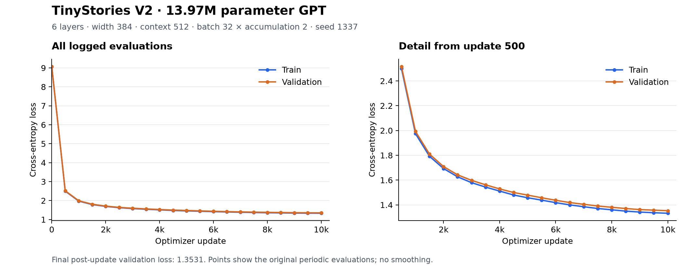

# M2 TinyStories 基线训练结果

执行日期：2026-11-02（Asia/Hong_Kong）。执行者：Codex。正式训练、三份样例和结果归档已完成；配置和运行结果已推送到 m2-baseline（结果提交 0e344fb，训练来源 45e78f1），M2 最终验收待用户与 Claude Code 核对。

## 真实运行结果

完整 10,000 步，327,680,000 个训练 token；最终 train 1.332559 / val 1.353057；82,756.28 tokens/s；PyTorch 已分配显存峰值 5006.78 MiB；主循环 3959.579s（65.99 分钟）。正式过程从第 0 步开始，未中断、未续训。开始 2026-11-02T12:19:20.221283+08:00，结束 2026-11-02T13:25:25.676397+08:00。来源 `45e78f1e718f70b322d0e817e47eb8e7272d5773`，完整参数见 `configs/tinystories_base.yaml`。

21 次周期评估的 val loss 均下降。吞吐计时包含主循环内评估和定期存档，不含最后额外评估及最终存档。显存峰值为 PyTorch allocated memory，整卡占用另见 GPU 监测。

| step | train loss | val loss | learning rate |
| --- | --- | --- | --- |
| 0 | 9.071807 | 9.071947 | 2e-06 |
| 500 | 2.500818 | 2.516208 | 0.00059943365 |
| 1000 | 1.974577 | 1.992666 | 0.00059308942 |
| 1500 | 1.791938 | 1.809506 | 0.00057985963 |
| 2000 | 1.693244 | 1.709026 | 0.00056009052 |
| 2500 | 1.626828 | 1.642547 | 0.00053429949 |
| 3000 | 1.579263 | 1.597809 | 0.00050316154 |
| 3500 | 1.543568 | 1.561861 | 0.00046749161 |
| 4000 | 1.511615 | 1.528851 | 0.00042822326 |
| 4500 | 1.479594 | 1.499977 | 0.00038638421 |
| 5000 | 1.457583 | 1.478790 | 0.00034306947 |
| 5500 | 1.438322 | 1.457491 | 0.00029941268 |
| 6000 | 1.418083 | 1.437410 | 0.00025655643 |
| 6500 | 1.400142 | 1.418763 | 0.00021562233 |
| 7000 | 1.385222 | 1.404845 | 0.00017768172 |
| 7500 | 1.370954 | 1.391051 | 0.00014372758 |
| 8000 | 1.360263 | 1.380636 | 0.00011464856 |
| 8500 | 1.349717 | 1.370650 | 9.1205706e-05 |
| 9000 | 1.342084 | 1.362035 | 7.4012569e-05 |
| 9500 | 1.336661 | 1.357512 | 6.3519128e-05 |
| 9999 | 1.332517 | 1.352962 | 6e-05 |

## 三份生成样例的逐份核对（Codex）

3 份样例均有英文儿童故事的角色、事件和对话结构；seed 2 第一篇较连贯，但 seed 1 有物品/行为衔接不清，seed 3 有行为与结尾寓意矛盾。固定 300 token 的输出在后续故事中出现截断，尚不能称三份均逻辑连贯。

- seed 1：Kitty 与男子玩球的角色和对话清晰，但先说借球，随后写 She gave the man his work，物品与行为衔接不清；Spot 的故事有开头和结尾，情节较松散；最后停在新故事开头。
- seed 2：第一篇 Tim 参加家人准备的聚会、玩耍后睡觉，结构完整且相对连贯；第二篇 Tom/Max 发现箱中藏着狗，保持叙事和对话，但固定长度在 They were surprised, 后截断。
- seed 3：Fin 没有听 Carl 的警告并把发热物带回家，结尾却说从此总听朋友的话并远离热物，出现明确因果/寓意矛盾；后续青蛙与鸟的故事有叙事结构，但感谢的动机不足；最后一篇爬树故事被截断。

三份原文见 `experiments/m2_tinystories_base/samples.txt`；生成参数严格沿用手册。短样例评价不替代更广泛的生成质量测试。

## 验证、资源和版本保护

- 今天实际执行：109 passed in 3.82s；ruff check 与 format --check（57 files）通过；CUDA 张量分配成功。锁文件与既有代码未改。
- 正式 GPU 利用率均值 98.71%，功耗均值 88.30 W，温度均值/最高 85.61/88.7°C；整卡显存最高 6969 MiB。采样包含初始化和收尾；利用率高不等于理论 FLOPS 效率达到峰值。
- 全量数据于 11/01 准备：train 536,174,492 / valid 5,414,548 token，词表 8192，官方 valid 独立验证；准备耗时约 149.3s、内存峰值约 1.24 GiB，不含预下载耗时。数据原文哈希和预处理统计见 data_info.json；本轮二进制与词表的内容指纹见 data_checksums.json。
- 两次 11/01 短跑和 11/02 累积 2 次短测的原始 run.json 已归档；均未写入正式结果表。配置本地提交只因文件权限修正 amend 过一次，内容不变，原始短测 commit 与说明均保留。
- 第 1000 步存档已检查优化器与随机数元数据；本次没有真实中断续训测试。原始 checkpoint 和数据只保存在 Ubuntu 忽略目录。
- 本次未新增独立代码审查。旧实验表内容与全部历史交接记录保留；results.md 只追加真实 M2-1。

## 文件与下一步

Ubuntu 工作区：`/home/j/transformer-lab`。小型归档：`experiments/m2_tinystories_base/`。完整本机执行与 GPU 原始日志：`runs/m2_train_20261102/`。Windows 查看副本：`C:\Users\J\Documents\ChatGPT\transformer\transformer-lab`。

正式配置和本次结果已推送到 m2-baseline；结果提交 0e344fb，后续文档补充以分支 Git 日志为准。用户回到 Mac 后，让 Claude Code pull 后读取 PROGRESS.md 和归档，再判断是否达到 M2 验收；合并 main 另行决定。

自测：为什么周期评估最后一行与最终 run.json 可能略有不同？为什么不能拿 M1 字符级 loss 与这里的 BPE loss 直接比较？

## 本次训练评价与当前进度

这次训练建立了可复现的工程基线，模型质量仍需验收。完整 10,000 步没有观察到 OOM、NaN 或发散，21 次周期验证 loss 均下降，最终 train/val 差约 0.0205；从这组固定验证样本曲线看，未见训练改善而验证恶化的明显过拟合信号。66 分钟符合 M2 的 1–2 小时时间预算，GPU 也一直忙碌；98.7% 利用率不等同于理论 FLOPS 已达到峰值。

文本已学会儿童故事的句式、角色和对话，但因果一致性还不可靠。seed 3 的“没有听提醒却得出听朋友话的寓意”是真实质量限制；固定长度输出在下一篇故事中截断，主要与 300 token 的生成上限有关，应单独判断。当前只有一个训练种子，不能据此下多种子稳定性或结构优劣结论。

| 阶段 | 当前状态 | 还缺什么 |
| --- | --- | --- |
| M0 环境与工程 | 已完成 | 既有 Mac/WSL 测试与 tiny 运行证据保留 |
| M1 字符级 GPT | 已完成并合入 main | 莎士比亚正式训练结果已归档 |
| M2 BPE / 数据 / 基建 / 基线 | A/B/C 已合入 main；D 的训练与产物已完成 | Claude 审查，用户判断故事质量是否验收，再决定合并 |
| M3 现代组件与消融 | 尚未开始 | RoPE、RMSNorm、SwiGLU、GQA/KV cache 与 A1–A4 对照 |
| M4 Qwen3 权重对齐 | 尚未开始 | 自研架构加载官方权重并逐层对齐 |
| M5 LoRA / GSM8K SFT | 尚未开始 | 手写 LoRA、训练与评测、PEFT 对照 |
| M6 收尾 | 尚未开始 | README 定稿、完整报告、简历和面试材料 |

2026-11-02 是计划 W2 的第一天，当前处于 M2 收尾。MVP 的关口仍是 11/15 前把 A1–A4 结果做成可复现的对照表，不宜把这次基线完成等同于整个 MVP 完成。建议先完成 Claude 审查；验收合并后，再确定统一 token 预算与至少两个训练 seed，按单变量原则推进 M3，优先从位置编码对照切入。

## Claude 审查入口

1. 在 Mac 的既有仓库执行 `git fetch origin`，切到 `m2-baseline` 并 `git pull --ff-only`，先核对工作区是否有自己的改动。
2. 以 `8056ac0`（已合入 main 的训练基建）为固定基线查看本分支；这次新增的是任务 D 手册、配置及运行证据，没有改写用户手写实现。
3. 核对 `configs/tinystories_base.yaml` 与 `run.json` 的完整参数、训练来源 `45e78f1`、10,000 步和 327,680,000 token；区分结果提交与训练代码提交。
4. 核对 `metrics.csv`、最终元数据和曲线。CSV 的最后一次评估发生在第 9999 步更新之前，run.json 的 final loss 是更新之后另行评估，微小差异不等于记录冲突。
5. 阅读全部 `samples.txt`，重点核对角色/物品的一致性、因果关系与结尾寓意；不要只依据 loss 判定故事已连贯。
6. 数据源及指纹见 `data_info.json` / `data_checksums.json`；GPU 摘要、环境和保护检查见 `gpu_summary.json` / `env_check.txt` / `validation.json`。真实 GPU 中断续训未实测，存档元数据检查不代替它。
7. 只有一个训练 seed 1337，seed 1/2/3 是生成抽样种子。若之后讨论结构改进或稳健性，按 PLAN 的同 token 预算、单变量、至少两训练 seed 另做对照。
8. 审查意见追加到 PROGRESS.md，由用户决定是否验收 M2、合并 main，以及开始 M3。当前状态不能写成“Claude 已通过”。
